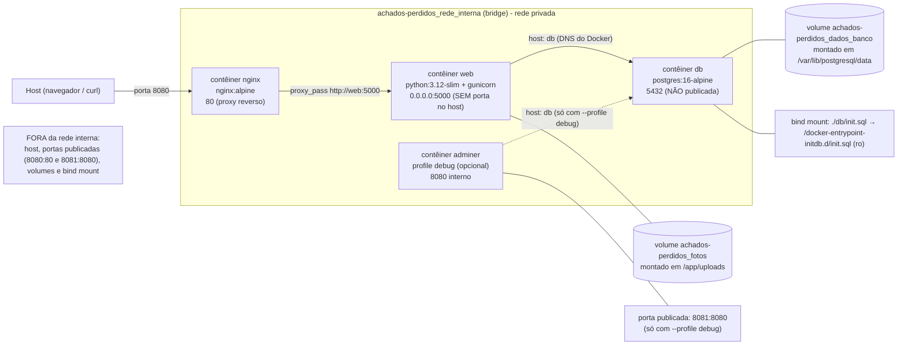

# Diagrama de arquitetura

Visão do ambiente: host, portas publicadas, contêineres, rede interna, volumes
e bind mount. Rede confirmada: `achados-perdidos_rede_interna`.

## Visão geral (Mermaid)

## O que fica dentro e fora da rede interna

| Componente | Dentro da rede? | Observação |
| --- | --- | --- |
| Contêiner `nginx` | Sim | Único ponto de entrada da aplicação; publica `8080:80` e encaminha para `web:5000` |
| Contêiner `web` | Sim | Não publica porta no host: só é acessível pelo nginx, via rede interna |
| Contêiner `db` | Sim | Acessível apenas como `db` de dentro da rede; sem porta no host |
| Contêiner `adminer` | Sim (opcional) | Sobe só com `--profile debug`; publica `8081:8080` |
| Volumes (`dados_banco`, `fotos`) | Fora | São recursos do engine Docker, montados nos contêineres |
| Bind mount `init.sql` | Fora | Arquivo do host, somente leitura |
